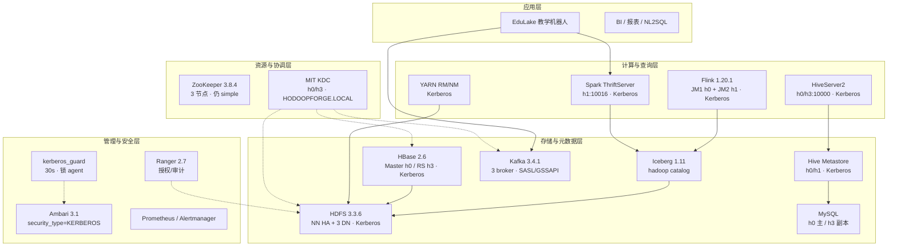

> **Note:** This technical guide is currently maintained in Chinese. The interactive map and product pages are fully bilingual; the detailed engineering reference below remains in Chinese until an English edition is published.


> 版本：2026-11-26（Kerberos 数据面版）  
> 状态：**Ambari `security_type=KERBEROS`；手工 Kerberos + 防呆守护**  
> 单一事实源：[`CURRENT_STATE.md`](/docs/hodoopforge/current-state/)  
> Kerberos 细节：[`KERBEROS_ENABLEMENT.md`](/docs/hodoopforge/kerberos-enablement/) · [`KERBEROS_GUARD.md`](/docs/hodoopforge/kerberos-guard/)  
> 交互地图：[`lake-map.html`](/maps/hodoopforge-lake-map.html)

---

## 1. 设计结论（先看这里）

HodoopForge 当前是 **4 容器、单宿主机、容器级 HA** 的 Hadoop 数据湖：

- **控制面**：Ambari Server / MySQL / KDC 主备 / Ranger / Prometheus；
- **数据面**：HDFS/HBase/Hive/YARN/Flink/Kafka/Spark 全部已启用 Kerberos；
- **管理方式**：Ambari 已置 `security_type=KERBEROS`，但 **`ambari-agent` 由
  `kerberos_guard` 锁定**，防止 Ambari 用旧 simple 配置覆盖手工 Kerberos；
- **认证**：MIT KDC `HODOOPFORGE.LOCAL`，服务 keytab + 客户端 `kinit`；
- **仍未 Kerberos 化**：ZooKeeper、Ranger Admin/KMS、TLS。

> 这是“业务可用优先”的 Kerberos 形态：数据面已强认证，控制面仍保留
> simple ZK / Ranger/KMS，后续可单独推进。

---

## 2. 物理与逻辑拓扑

### 2.1 宿主机

| 项 | 值 |
|---|---|
| 宿主机 | `192.168.0.60`（48GB / 500G 级磁盘） |
| 容器网络 | `172.19.0.0/16` |
| Ambari | `http://192.168.0.60:20609` |
| 外部 Kafka | `192.168.0.60:9092/9093/9094`（SASL_PLAINTEXT） |
| 外部 Hive | `192.168.0.60:10000`（Kerberos） |
| 外部 Spark | `192.168.0.60:10016`（Kerberos） |
| 外部 HBase | `192.168.0.60:16010/16030` |

### 2.2 四个容器

| 容器 | IP | 角色 |
|---|---|---|
| `bigtop_hostname0` | `172.19.0.2` | NameNode(Standby)、RM、HBase Master、HMS/HS2、Ranger、Flink JM1、Kafka 1001、ZK、Ambari、KDC、MySQL 主 |
| `bigtop_hostname1` | `172.19.0.5` | Spark ThriftServer、HMS、DataNode、NodeManager、ZK、JN、Flink JM2、监控主、ATS |
| `bigtop_hostname2` | `172.19.0.3` | Kafka 1002、DataNode、NodeManager、ZK、Flink TM |
| `bigtop_hostname3` | `172.19.0.4` | NameNode(Active)、HBase RegionServer、HS2、MySQL 副本、DataNode、NodeManager、JN、ZKFC、Kafka 1003、Flink TM、KDC 备 |

> NameNode Active 当前在 h3；h0 为 Standby。任一侧故障时 ZKFC 自动选主。

### 2.3 逻辑分层



---

## 3. 数据流

### 3.1 实时入湖（Kafka → Flink → Iceberg）

```text
业务应用 / 探针
  │  SASL_PLAINTEXT + GSSAPI（flink-qixuandata 或业务 principal）
  ▼
Kafka 3 broker（h0/h1/h2/h3 中的 1001/1002/1003）
  │  主题：ai_inference_log / rag_query_log / answer_sample_log
  ▼
Flink 作业 edulake-realtime-ingest
  │  keytab: flink.headless.keytab
  │  checkpoint 20s，Exactly-Once
  ▼
Iceberg Hadoop Catalog
  hdfs://qixuandata/iceberg-warehouse-ha
```

### 3.2 批处理 / 查询（Spark / Hive → Iceberg/HDFS）

```text
BI / JDBC 客户端
  │  kinit + principal
  ▼
Spark ThriftServer h1:10016  或  HiveServer2 h0/h3:10000
  │  YARN / Tez 执行
  ▼
Iceberg -ha + HDFS / HMS(MySQL)
```

### 3.3 元数据与治理

- Hive Metastore：h0/h1 双实例，元数据库 MySQL h0 主 / h3 异步副本；
- Iceberg：业务读与 Flink 写统一到 `-ha` 仓库，旧 `/iceberg-warehouse` 保留；
- Ranger：HDFS/Hive/HBase 策略与审计；Ranger/KMS 尚未 Kerberos 化；
- 质量/血缘/成本：`edulake_meta` 表 + 业务探针。

---

## 4. 认证与授权

### 4.1 Kerberos 主体

| 服务 | Principal | Keytab |
|---|---|---|
| NameNode | `nn/bigtop-hostname0...` / `nn/bigtop-hostname3...` | `nn.service.keytab` |
| JournalNode | `jn/bigtop-hostname0/1/3...` | `jn.service.keytab` |
| DataNode | `dn/bigtop-hostname1/2/3...`（显式 FQDN） | `dn.service.keytab` |
| ResourceManager | `rm/bigtop-hostname0...` | `rm.service.keytab` |
| NodeManager | `nm/bigtop-hostname1/2/3...` | `nm.service.keytab` |
| HBase | `hbase/bigtop-hostname0/3...` | `hbase.service.keytab` |
| Hive | `hive/bigtop-hostname0..3...` | `hive.service.keytab` |
| Spark | `spark/bigtop-hostname1...` | `spark.service.keytab` |
| Flink | `flink-qixuandata@HODOOPFORGE.LOCAL` | `flink.headless.keytab` |
| Kafka | `kafka/192.168.0.60@HODOOPFORGE.LOCAL`（共享） | `kafka.service.keytab` |
| Ambari Server | `ambari-server-qixuandata@...` | `ambari.server.keytab` |

### 4.2 关键认证链路

1. **HDFS**：NN/JN 用 `_HOST`；DN 用 `/etc/hadoop/conf-dn` 的显式 FQDN
   principal；RPC Kerberos，web 仍 simple。
2. **HBase**：Master/RS 用 `hbase/<host>`；`zookeeper.znode.parent=/hbase`；
   ZK 客户端关闭 SASL。
3. **Hive**：HMS SASL + HS2 KERBEROS；HS2 ZK 动态发现暂时关闭，客户端
   使用 `;principal=hive/<host>@HODOOPFORGE.LOCAL`。
4. **YARN**：RM/NM keytab + LinuxContainerExecutor；
   `container-executor` 必须 `6050 root:hadoop`。
5. **Kafka**：broker 使用共享 `kafka/192.168.0.60` principal；客户端
   `SASL_PLAINTEXT + GSSAPI`。
6. **Flink**：`flink.headless.keytab`；`zookeeper.sasl.disable=true`；
   移除 Ranger KMS provider 依赖；Kafka 客户端显式 JAAS。
7. **Spark**：ThriftServer `--principal spark/... --keytab spark.service.keytab`；
   `spark.yarn.timeline-service.enabled=false` 绕过 ATS 委托令牌。

### 4.3 客户端要求

| 客户端 | 要求 |
|---|---|
| HDFS | `kinit` 或 keytab；不能匿名 |
| HBase | `hbase.security.authentication=kerberos` + `kinit` |
| Hive JDBC | `kinit` + `principal=hive/<host>@HODOOPFORGE.LOCAL` |
| Spark JDBC | `kinit` + `principal=spark/bigtop-hostname1...` |
| Kafka | `security.protocol=SASL_PLAINTEXT`、`sasl.mechanism=GSSAPI`、`sasl.kerberos.service.name=kafka` + JAAS/keytab |
| 外部 Kafka | 同上；advertised 为 `192.168.0.60:9092/9093/9094` |

### 4.4 仍未 Kerberos 化

- ZooKeeper 仍 simple（客户端通过 `zookeeper.sasl.client=false` 连接）；
- Ranger Admin / Ranger KMS 仍非 Kerberos，日志有 401/404；
- TLS 未启用（Kafka 当前为 SASL_PLAINTEXT，不是 SASL_SSL）。

---

## 5. 高可用与故障域

| 组件 | HA 方式 | 故障表现 / 处理 |
|---|---|---|
| HDFS | 2 NN + 3 JN + 2 ZKFC + 3 DN | 自动选主；`hdfs haadmin -getAllServiceState` |
| Kafka | 3 broker、RF3、minISR=2 | 单 broker 故障不影响；systemd `kafka-broker` |
| HBase | Master h0 + RS h3 | Master/RS 手工拉起；ZK 路径 `/hbase` |
| Hive | HMS h0/h1、HS2 h0/h3 | 单实例故障客户端重试另一 URI |
| YARN | RM h0 + 3 NM | RM/NM 重启由 guard 补起 |
| Flink | JM1 h0 + JM2 h1、ZK 选主、HDFS HA 元数据 | 作业从 savepoint/checkpoint 恢复 |
| MySQL | h0 主 / h3 异步副本 | `scripts/mysql_failover.sh` |
| 监控 | Prometheus 主备 + 统一查询代理 | `scripts/monitoring/failover.sh` |

---

## 6. 端口与入口

| 服务 | 端口 | 位置 |
|---|---|---|
| Ambari | 20609 | 宿主机 → h0 |
| HDFS RPC / UI | 8020 / 50070 | h0/h3 |
| HBase Master / UI | 16000 / 16010 | h0 |
| HBase RS / UI | 16020 / 16030 | h3 |
| HiveServer2 | 10000 | h0/h3 |
| HMS | 9083 | h0/h1 |
| Spark ThriftServer | 10016 | h1 |
| YARN RM / UI | 8050 / 8088 | h0 |
| Flink JM | 8081 | h0/h1 |
| Kafka | 9092/9093/9094 | 外部 192.168.0.60 |
| ZooKeeper | 21810/12181/22181 | 宿主机映射 |
| MySQL | 13306 | 宿主机映射 |
| Prometheus / Alertmanager | 9090 / 19093 | 宿主机 |
| Grafana | 3000 | h0 |

---

## 7. 管理与防呆

### 7.1 手工 Kerberos 模式

Ambari 已置 `security_type=KERBEROS`，但 **agent 被锁定**：

- `kerberos_guard` 每 30 秒：
  - 停止并锁住 4 个容器的 `ambari-agent`；
  - 检测配置漂移并恢复 `core-site/hdfs-site/yarn-site/hbase-site/hive-site/flink-conf`；
  - 补起 HDFS/HBase/Hive/YARN/Flink/Kafka；
  - 保存 `/etc/security/keytabs` 快照；
  - **不调用宿主 `systemctl stop/disable`**，不触发 polkit 密码弹窗。
- 旧 60s `hodoopforge-watchdog.timer` 已停止；`hodoopforge-healthcheck.timer` 仍每 10 分钟只读巡检。

### 7.2 为什么锁 Agent

Ambari DB 仍是旧 simple 配置；一次“Start/Restart”会覆盖：

- `/etc/hadoop/conf`、`/etc/hadoop/conf-dn`
- `/etc/hbase/conf`、`/etc/hive/conf`
- `/etc/spark/conf`、`/etc/kafka/conf`
- `/etc/security/keytabs`

2026-11-26 Ambari 收口请求已实际覆盖过 h0 的 `nn/jn/kafka` keytab，已恢复。
因此 **锁 agent 是当前设计的一部分**，不是故障。

### 7.3 允许的操作

- 只读：Ambari UI 查看、Prometheus、Grafana、`kerberos_guard status`；
- 受控：`kerberos_guard --fix`、`scripts/kerberos_hdfs_enable.sh rollback`；
- 禁止：Ambari 启动/重启 HDFS/HBase/Hive/YARN、手工 `systemctl start` 这些服务。

---

## 8. 健康检查

```bash
# 防呆守护
KERBEROS_GUARD_HOME=$HOME/.hodoopforge-kerberos \
  python3 scripts/kerberos_guard.py status

# HDFS
docker exec bigtop_hostname0 bash -c "su -s /bin/bash hdfs -c 'export HADOOP_CONF_DIR=/etc/hadoop/conf; \
  kinit -kt /etc/security/keytabs/hdfs.headless.keytab hdfs-qixuandata@HODOOPFORGE.LOCAL; \
  hdfs haadmin -getAllServiceState; hdfs dfsadmin -report | grep -E \"Live datanodes|Missing blocks\"; kdestroy'"

# Flink
curl -s http://172.19.0.2:8081/jobs/overview

# Kafka / Spark / Hive / HBase / YARN
for spec in "172.19.0.2 9092" "172.19.0.5 10016" "172.19.0.2 10000" "172.19.0.2 16000" "172.19.0.2 8050"; do
  set -- $spec; timeout 2 bash -c "</dev/tcp/$1/$2" && echo "$1:$2 ok"
done
```

---

## 9. 变更与回滚

| 场景 | 操作 |
|---|---|
| HDFS 回滚 simple | `bash scripts/kerberos_hdfs_enable.sh rollback` |
| HBase/Hive/YARN/Flink/Kafka 回滚 | 恢复对应 `.simple.bak` / `.pre-kerberos.bak`，重启服务，最后 Ambari `STARTED` 收口 |
| Ambari 收口前备份 | `/tmp/ambari-cutover-20261126-103555/`（Ambari MySQL + 4 节点配置/keytab） |
| 配置漂移 | `kerberos_guard --fix` 自动恢复；手工恢复用 guard snapshot |
| keytab 被覆盖 | `~/.hodoopforge-kerberos/kerberos-snapshot/h<N>/keytabs.tgz` 解包恢复 |

---

## 10. 已知限制

1. Ambari UI 的 Agent/服务状态不实时（agent 锁定）；以本文件和直接探针为准。
2. Ambari `ServiceInfo/kerberos_enabled` 仍显示 false；集群级 `security_type=KERBEROS` 已生效。
3. `cluster-env/kerberos_domain` 仍是 `EXAMPLE.COM`（Ambari DB 元数据）；`kerberos-env/realm` 与磁盘均为 `HODOOPFORGE.LOCAL`。
4. ZooKeeper / Ranger / Ranger KMS / TLS 未 Kerberos 化。
5. Flink 作业不会自动重新提交；丢失时需从 savepoint 手工恢复。
