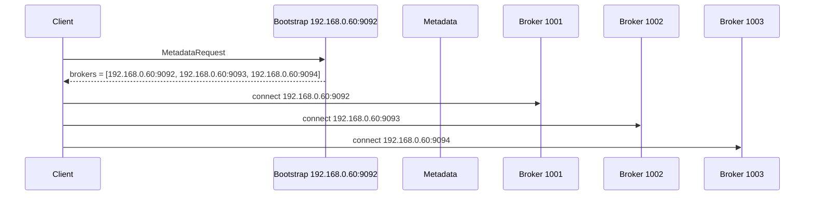

> **文档编号**：HODOOPFORGE-KAFKA-EXT-002  
> **版本**：v3.0 · 2026-11-26（SASL_PLAINTEXT/GSSAPI）  
> **读者**：应用侧、平台运维、架构  
> **关联问题**：应用侧只能写 partition 0，依赖 `EDULAKE_KAFKA_PARTITION=0`  
> **关联脚本**：`scripts/kafka_external_listener.sh`、`ambari3/scripts/setup-nat-forward.sh`  
> **业务侧说明**：`KAFKA_ADVERTISED_LISTENER_RATIONALE_2026-11-09.md`

---

## 0. 一句话结论

**9093/9094 端口开放 ≠ Kafka 客户端可用。**  
平台开放的是 bootstrap 端口；Kafka 返回给客户端的是 `advertised.listeners`。  
因此本次把三个 broker 的 advertised 地址统一改为应用宿主可直达的：

```properties
192.168.0.60:9092
192.168.0.60:9093
192.168.0.60:9094
```

应用侧可删除 `EDULAKE_KAFKA_ADVERTISED_HOST_OVERRIDE` 和 `EDULAKE_KAFKA_PARTITION=0`。

---

## 1. 问题复盘

### 1.1 现象

Kafka 有 3 个 broker：

| Broker | 主机 | 容器地址 |
|---|---|---|
| 1001 | h0 | `172.19.0.2:9092` |
| 1002 | h2 | `172.19.0.3:9092` |
| 1003 | h3 | `172.19.0.4:9092` |

宿主机只做了 `9092 → h0:9092` 时，外部客户端只能连 broker 1001，partition 1/2 的 leader 指向 1002/1003，客户端连不上，只能强制写 partition 0。

### 1.2 第一次修复为什么“看起来 OK”

第一次把 advertised 改成 `as.long.kim:9092/9093/9094`，并开放了宿主机 9093/9094。  
但 `as.long.kim` 解析到公网 `202.105.190.2`，从应用宿主（`192.168.0.168`）不可达；应用侧只是用 Python 进程内的 DNS override 把 `as.long.kim` 改写为 `192.168.0.60`，所以“应用能写”并不等于“标准客户端可用”。

### 1.3 正确判断

Kafka 客户端流程：



bootstrap 只负责“问路”；真正的生产/消费要连 metadata 返回的每个 broker。  
如果 advertised 地址不可达，标准 Java/Python/Go/CLI/监控客户端都会失败。

---

## 2. 最终方案

### 2.1 端点

| Broker | 外部端点 | 宿主机 DNAT |
|---|---|---|
| 1001 | `192.168.0.60:9092` | 9092 → h0:9092 |
| 1002 | `192.168.0.60:9093` | 9093 → h2:9092 |
| 1003 | `192.168.0.60:9094` | 9094 → h3:9092 |

### 2.2 Kafka `server.properties`

| 主机 | 配置 |
|---|---|
| h0 | `advertised.listeners=SASL_PLAINTEXT://192.168.0.60:9092` |
| h2 | `advertised.listeners=SASL_PLAINTEXT://192.168.0.60:9093` |
| h3 | `advertised.listeners=SASL_PLAINTEXT://192.168.0.60:9094` |

`listeners` 保持容器内地址不变：

```properties
listeners=SASL_PLAINTEXT://bigtop-hostnameN.bigtop.apache.org:9092
```

> advertised 端口可以不同于 listener 端口；宿主机 DNAT 负责把 9093/9094 转到对应 broker 的 9092。  
> **2026-11-26 起 broker 使用 SASL_PLAINTEXT/GSSAPI；客户端必须提供 JAAS/keytab。**

### 2.3 宿主机 DNAT

规则同时写入 `PREROUTING`（外部进入）和 `OUTPUT`（宿主机本地访问）：

```text
9092 → 172.19.0.2:9092
9093 → 172.19.0.3:9092
9094 → 172.19.0.4:9092
```

### 2.4 容器内 hairpin

每个容器需要能直达 `192.168.0.60:9092/9093/9094`，否则本机客户端会 hairpin 失败：

| 容器 | 本地 DNAT |
|---|---|
| h0/h1/h2/h3 | `192.168.0.60:9092 → 172.19.0.2:9092` |
| h0/h1/h2/h3 | `192.168.0.60:9093 → 172.19.0.3:9092` |
| h0/h1/h2/h3 | `192.168.0.60:9094 → 172.19.0.4:9092` |

---

## 3. 应用侧接入

### 3.1 推荐配置

```properties
bootstrap.servers=192.168.0.60:9092,192.168.0.60:9093,192.168.0.60:9094
acks=all
```

删除：

```text
EDULAKE_KAFKA_PARTITION=0
EDULAKE_KAFKA_ADVERTISED_HOST_OVERRIDE=
EDULAKE_KAFKA_ADVERTISED_PORTS=
```

保留：

```text
EDULAKE_KAFKA_BROKERS=192.168.0.60:9092,192.168.0.60:9093,192.168.0.60:9094
```

### 3.2 网络前提

- 应用宿主 `192.168.0.168` 与平台宿主 `192.168.0.60` 在同一局域网；
- 应用宿主可直达 `192.168.0.60:9092/9093/9094`；
- **不再依赖 `as.long.kim` 公网地址**，也不依赖 hosts/override。

> 如果未来要公网访问 Kafka，建议走 VPN/专线，或单独启用 SASL/SSL + 白名单，不要直接把 PLAINTEXT 暴露到公网。

---

## 4. 平台侧操作

### 4.1 一键检查 / 应用 / 验证

```bash
./scripts/kafka_external_listener.sh status
./scripts/kafka_external_listener.sh apply
./scripts/kafka_external_listener.sh verify
```

### 4.2 滚动重启（首次配置时）

顺序：h2 → h3 → h0；每次等 ISR 恢复后再下一个。

```bash
docker exec bigtop_hostname2 bash -c "su -s /bin/bash kafka -c '/usr/bigtop/current/kafka-broker/bin/kafka-server-stop.sh'"
docker exec bigtop_hostname2 bash -c "su -s /bin/bash kafka -c 'LOG_DIR=/var/log/kafka /usr/bigtop/current/kafka-broker/bin/kafka-server-start.sh -daemon /usr/bigtop/current/kafka-broker/config/server.properties'"
```

每步后检查：

```bash
kafka-topics.sh --bootstrap-server 192.168.0.60:9092,192.168.0.60:9093,192.168.0.60:9094 --describe
```

期望：68 个业务分区全部 `Isr: 3`。

---

## 5. 验证证据（2026-11-10）

### 5.1 标准 Kafka CLI metadata（无任何 override）

```text
192.168.0.60:9092 (id: 1001)
192.168.0.60:9093 (id: 1002)
192.168.0.60:9094 (id: 1003)
```

### 5.2 副本与 ISR

```text
partitions = 68
replica_count = {3: 68}
isr_count     = {3: 68}
```

### 5.3 三分区写入

```text
kafka-ext-write-test:0:11
kafka-ext-write-test:1:9
kafka-ext-write-test:2:10
```

30 条带 key 消息全部写入，三分区 offset 均大于 0。

### 5.4 Flink 实时作业

```text
state = RUNNING
checkpoints = 2541 completed / 0 failed
```

### 5.5 Ambari

```text
97 OK / 0 CRITICAL / 0 UNKNOWN
```

### 5.6 业务侧复验（待应用侧执行）

```bash
.venv/bin/python scripts/verify_kafka_external.py --produce
```

期望：

```json
{
  "advertised": [
    {"node_id": 1001, "host": "192.168.0.60", "port": 9092, "tcp_ok": true},
    {"node_id": 1002, "host": "192.168.0.60", "port": 9093, "tcp_ok": true},
    {"node_id": 1003, "host": "192.168.0.60", "port": 9094, "tcp_ok": true}
  ],
  "advertised_all_reachable": true,
  "status": "platform_ok"
}
```

应用侧验收通过后，删除 `EDULAKE_KAFKA_ADVERTISED_HOST_OVERRIDE`，用标准客户端再跑一次三分区写入。

---

## 6. 回滚

```bash
# 1) 恢复 broker 配置（每台都有备份）
cp /usr/bigtop/current/kafka-broker/config/server.properties.bak.20261109-kafka-ext \
   /usr/bigtop/current/kafka-broker/config/server.properties

# 2) 按 h2 → h3 → h0 顺序重启 broker

# 3) 删除宿主机 9093/9094 DNAT
# 使用 setup-nat-forward.sh remove / apply 重建，或手工删除

# 4) 应用侧恢复原配置（如确需回滚）
```

---

## 7. 运维与安全建议

1. **advertised 地址必须是客户端可达地址**：这是 Kafka 的硬约束，不要用“公网域名 + 客户端 override”长期兜底。
2. **端口开放只是必要条件**：验收必须看 metadata 返回的每个 broker 是否可达，而不是只看 bootstrap 端口。
3. **标准客户端验收**：Java/Python/Go/CLI/监控至少各跑一次，不依赖应用进程内的 DNS 改写。
4. **安全**：当前为 PLAINTEXT，建议防火墙限制来源 IP；公网访问必须加 VPN/专线或 SASL/SSL。
5. **持久化**：
   - 宿主机 DNAT 已写入 `setup-nat-forward.sh`（V2.7），可用 `persist` 保持开机自恢复。
   - 容器 hairpin 规则为运行时规则，容器重建后执行 `./scripts/kafka_external_listener.sh apply`。
   - Kafka `advertised.listeners` 在容器 `server.properties` 中，容器重建后需重新应用（建议纳入初始化脚本）。

---

## 8. 关联文档

- `manual/10-ha-and-business-connectivity.md` — HA 与业务联通验收
- `screenshots/61-kafka-rf3.jpeg` — Kafka RF3 证据
- `HA_PROGRESS_REPORT_2026-11-09_HDFS_HA.md` — 平台交付报告

---

## 9. 2026-11-18 修复记录（NAT 补齐 + advertised 修正）

### 9.1 发现的问题

| 项 | 状态 |
|---|---|
| 宿主机 DNAT 9093/9094 | ❌ 缺失（V2.7 规则未应用） |
| 容器 hairpin（访问 192.168.0.60） | ❌ 缺失 |
| h0 advertised.listeners | ❌ 未设置（默认内部域名） |
| h2 advertised.listeners | ❌ `bigtop-hostname2...:9092` |
| h3 advertised.listeners | ❌ `bigtop-hostname3...:9092` |

### 9.2 已执行的修复

1. 宿主机规则补齐并清理重复：
   ```bash
   sudo bash ambari3/scripts/setup-nat-forward.sh refresh
   ```
2. 容器 hairpin（h0/h1/h2/h3，h1 用于 kafka_exporter）：
   ```bash
   bash scripts/kafka_external_listener.sh apply
   ```
3. h0（Ambari 管理）：
   - 通过 Ambari `kafka-broker` 配置设置
     `advertised.listeners=PLAINTEXT://192.168.0.60:9092`
   - 重启 `KAFKA_BROKER`（request 745/746）
4. h2/h3（systemd 管理，非 Ambari 组件）：
   ```bash
   # h2
   sed -i 's|^advertised.listeners=.*|advertised.listeners=PLAINTEXT://192.168.0.60:9093|' \
     /etc/kafka/conf/server.properties
   systemctl restart kafka-broker
   # h3 同理，改为 192.168.0.60:9094
   ```
   > 修改前已备份为 `server.properties.bak.<timestamp>`。

### 9.3 验收结果

```text
$ kafka-broker-api-versions.sh --bootstrap-server 192.168.0.60:9092,192.168.0.60:9093,192.168.0.60:9094
192.168.0.60:9094 (id: 1003)
192.168.0.60:9092 (id: 1001)
192.168.0.60:9093 (id: 1002)

# 3 分区写入测试（nat-ext-test，测试后已删除）
nat-ext-test:0:4
nat-ext-test:1:5
nat-ext-test:2:3
```

- 无 under-replicated 分区；
- Flink 作业 `42c0fdb…` 保持 RUNNING。

### 9.4 注意事项

- **h2/h3 不是 Ambari 组件**，`server.properties` 是手工维护；容器重建后需重新执行 9.2 第 4 步。
- h0 是 Ambari 管理，配置在 Ambari `kafka-broker` 中，重启不会丢失。
- 宿主机重启后 `hodoopforge-nat.service` 会自动 refresh；容器 hairpin 不会自动恢复，需执行 `kafka_external_listener.sh apply`。
## 客户端 Kerberos 配置（2026-11-26）

```properties
security.protocol=SASL_PLAINTEXT
sasl.mechanism=GSSAPI
sasl.kerberos.service.name=kafka
```

```text
KafkaClient {
  com.sun.security.auth.module.Krb5LoginModule required
  useKeyTab=true storeKey=true
  keyTab="/path/to/client.keytab"
  principal="client@HODOOPFORGE.LOCAL"
  serviceName="kafka";
};
```

broker 使用共享 `kafka/192.168.0.60@HODOOPFORGE.LOCAL` principal；
外部客户端必须能访问 192.168.0.60:9092/9093/9094，并完成 kinit。
