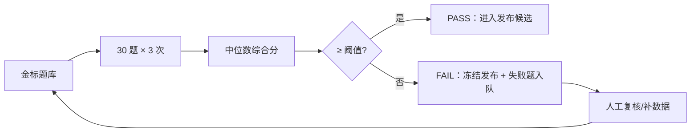
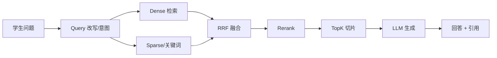

> **Note:** This technical guide is currently maintained in Chinese. The interactive map and product pages are fully bilingual; the detailed engineering reference below remains in Chinese until an English edition is published.

> 学习目标：理解 Edumind 的模型评测/门禁、RAG、ASR/TTS，以及“离线可用”的工程取舍。
> 规范文档：`doc/function/58`、`doc/function/29`、`doc/thirdpart/09`

---

## 1. Edumind 是什么

Edumind 是教育垂直大模型底座，负责：

- 基座模型下载/量化/部署（Ollama）；
- SFT/QLoRA 训练与适配器评测；
- 30 题 × 3 次中位数模型门禁；
- RAG 检索增强与答案证据链；
- ASR/TTS/说话人分离。

当前运行：

- `eduteacher:latest`（8.2B，Q4_K_M，Ollama + GPU）；
- 每日评测 timer；
- 训练后同题基线比较，未通过不进入发布候选。

---

## 2. 模型评测与门禁

关键口径：

- 不用单次分数做结论；
- 失败题保留指标与日志，回到复核队列；
- 训练任务只有 `completed` 才可进入候选；
- 门禁依赖评测新鲜度，评测过期不能“沿用旧 PASS”。

当前弱项：英语/语文部分题型；生产大模型训练需要外部 GPU/数据。

---

## 3. RAG 与答案证据链

要点：

- Qdrant 单 RPC 内 Dense+Sparse+RRF，降低延迟；
- rerank 有 lexical fallback，不依赖外部模型；
- 回答尽量带 citation；检索不到要明确“没有教材依据”，不要编造；
- 图片 OCR 未全量回填时，图片检索能力要标注边界。

---

## 4. 语音链路

| 能力 | 实现 | 当前状态 |
|---|---|---|
| ASR | faster-whisper（GPU） | CUDA 自动探测；P100/P4 回退 `float32` |
| 说话人分离 | sherpa-onnx pyannote + CAM++ | 4 人中文音频实测 4 speakers/10 cues |
| TTS | edge-tts | 支持双语译制配音；失败降级文字 |
| 口型 | VRM + 字幕 | 与 TTS 同步 |
| 数字人 | VRM 3D | Live2D 已退出口径 |

GPU 镜像：

- `open-llm-vtuber-app:gpu`；
- 含 faster-whisper/ctranslate2/sherpa-onnx/cuBLAS/cuDNN；
- 叠加 6 个依赖安全补丁（aiohttp/cryptography/python-multipart/urllib3/pyjwt/pillow）。

---

## 5. AI 工具台的“离线优先”设计

教学质检不依赖网络：

- 文本纠错/润色：规则 + 编辑距离；
- 作业查重：字符 n-gram + 最长公共片段；
- 公式规范化：文本/LaTeX 近似；
- 口语题生成：模板 + 知识点；
- 试卷质量：难度分布、区分度、基础/综合题提示。

LLM 可用时增强，不可用时回退本地算法；这样 CI 和课堂不被外部网络卡住。

---

## 6. 动手练习

1. 打开 AI 工具台 → 教学质检，输入一段学生答案，看纠错/润色/查重结果。
2. 找一个知识点，生成 3 道口语题，检查是否覆盖目标知识点。
3. 查看一次模型评测结果：总分、题数、是否 PASS、失败题。
4. 用 `/api/v1/tools/asr` 上传一段中文音频，观察 `device`/`speakers`/`cues`。

---

## 7. 自测题

1. 为什么模型门禁用 30 题 × 3 次中位数，而不是单次？
2. RAG 检索不到教材依据时，正确行为是什么？
3. P100/P4 为什么要回退 `float32`？
4. 哪些 AI 能力在离线时仍可用？为什么这样设计？
5. GPU 镜像是如何在不重建 15GB 基础镜像的情况下升级依赖的？
