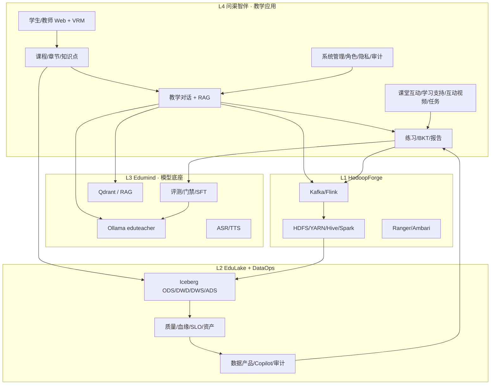
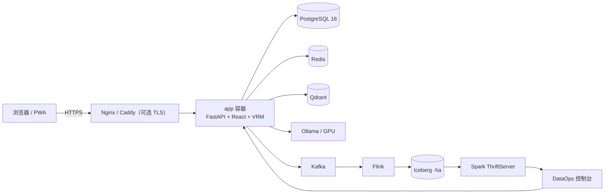
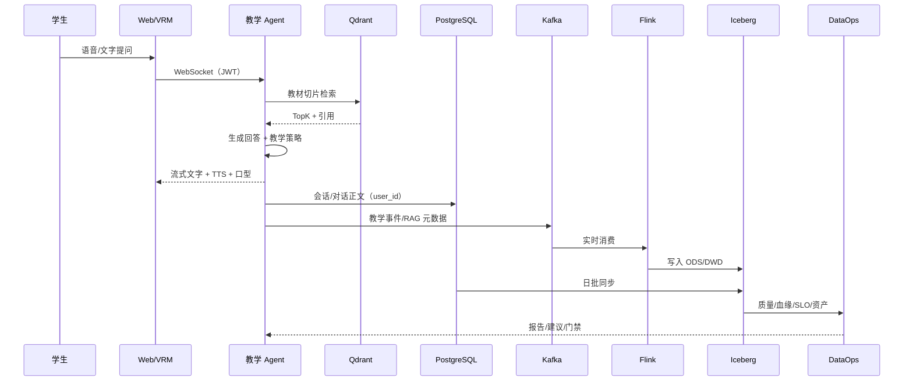

> 学习目标：画出四层架构和“学生提问 → 报告”的完整链路，理解为什么这样分层。
> 规范文档：`doc/function/50`、`doc/function/51`

---

## 1. 逻辑架构

关键原则：

1. **单校主线**：业务页不出现“租户”概念；多校只在系统管理。
2. **不建第二套库**：课程/练习/对话只落 PostgreSQL，湖仓做分析，不反写业务主库。
3. **事件不阻塞教学**：Kafka 失败先落 outbox，best-effort 投递。
4. **无数据不编造**：学习增益/画像无样本返回 `unknown`/`null`。
5. **外部依赖显式标注**：Kerberos、会议、教务、测评不在应用仓库里“模拟完成”。

---

## 2. 部署拓扑

| 组件 | 作用 | 当前状态 |
|---|---|---|
| `open-llm-vtuber-app:gpu` | 应用 + ASR/TTS + 静态前端 | healthy |
| PostgreSQL | 业务主库，105 表 | 运行中 |
| Redis | 缓存/限流/排行榜 | 运行中 |
| Qdrant | 教材/知识点向量 | 运行中 |
| Kafka | 事件总线 | RF3，应用支持 SASL |
| Flink | 实时入湖 | 运行中 |
| Iceberg | 湖仓，66 表 | `-ha` warehouse |
| Spark Thrift | 查询引擎 | SASL PLAIN |
| Ollama | 本地模型 | 单 GPU |

> 生产 TLS、Kerberos、KMS、SIEM 为外部/运维项；应用已提供 TLS 配置与 Nginx 样例。

---

## 3. 一条学生提问的完整链路

注意：

- 对话正文落 `conversation_messages`，新写入绑定 `user_id`；
- 事件优先走 Kafka，失败落 `teaching_events` outbox；
- RAG/LLM 元数据只传长度、耗时、chunk id 等，不传正文；
- 数据湖分析结果回到报告/建议，不直接改业务表。

---

## 4. 多租户与权限

| 层 | 机制 |
|---|---|
| 应用层 | `tenant_id` + `get_tenant_id`；平台管理员可切校；学校管理员/师生固定本租户 |
| 权限 | 四级角色 + 租户自定义角色（权限 JSON）；系统管理 15/15 写接口 `require_permission` |
| 会话 | JWT 120 分钟；`token_version` 撤销；登录限流 |
| 数据平台 | `tenant_registry`/湖表隔离仍待平台窗口 |

> 不要把“应用层多租户已上线”写成“数据平台多租户已完成”。

---

## 5. 关键设计取舍

| 取舍 | 选择 | 原因 |
|---|---|---|
| 单校 vs 多校 | 业务页单校，多校放系统管理 | 降低课堂复杂度，保留集团扩展 |
| 对话正文入湖 | DWD 脱敏后入湖 | 训练语料与隐私平衡 |
| 事件投递 | outbox + best-effort | 不让 Kafka 故障阻断教学 |
| 模型 | 本地 Ollama + 可选 GPU | 数据不出校，成本可控 |
| 确定性算法 | 纠错/查重/公式/试卷质量优先 | CI/课堂不依赖网络 |
| 删除语义 | 匿名化 + 脱敏，保留统计 | 不破坏班级/课程统计 |

---

## 6. 自测题

1. 为什么课程/练习只落 PostgreSQL，不直接写 Iceberg？
2. Kafka 挂了，教学对话会不会失败？为什么？
3. 应用层多租户和数据平台多租户分别做到哪一步？
4. 画出“学生提问 → 报告”的 8 个以上组件。
5. 哪些组件是单点，扩容时需要先改什么？
