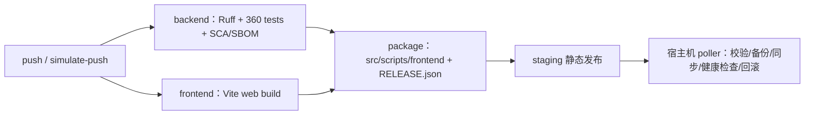

> **Note:** This technical guide is currently maintained in Chinese. The interactive map and product pages are fully bilingual; the detailed engineering reference below remains in Chinese until an English edition is published.


> 学习目标：能部署、发布、回滚、备份、恢复、排查常见故障，并知道哪些操作不能在生产随便做。
> 规范文档：`doc/function/52`、`doc/function/57`、`doc/thirdpart/10`

---

## 1. 运行拓扑

```text
浏览器/PWA
  ↓
Nginx/Caddy（可选 TLS）
  ↓
open-llm-vtuber-app（FastAPI + React + VRM）
  ├─ PostgreSQL 16
  ├─ Redis
  ├─ Qdrant
  ├─ Ollama / GPU ASR
  └─ Kafka → Flink → Iceberg → Spark → DataOps
```

---

## 2. 部署

### 2.1 启动

```bash
docker compose -f docker-compose.yml -f docker-compose.gpu.yml up -d
```

### 2.2 GPU 镜像

```bash
docker compose -f docker-compose.yml -f docker-compose.gpu.yml build app
docker compose -f docker-compose.yml -f docker-compose.gpu.yml up -d --no-deps app
```

- 镜像：`open-llm-vtuber-app:gpu`；
- 含 faster-whisper/ctranslate2/sherpa-onnx/cuBLAS/cuDNN；
- 叠加依赖安全补丁层；
- 源码/前端通过 bind mount 随发布更新，依赖变更需重建镜像。

### 2.3 健康检查

```bash
curl -fsS http://127.0.0.1:12393/live2d-models/info
docker inspect open-llm-vtuber-app --format '{{.State.Health.Status}}'
```

> 健康检查路径沿用历史命名 `/live2d-models/info`，不代表 Live2D 仍在用；数字人已统一 VRM。

---

## 3. CI/CD（Qixuan CloudBuild）



当前基线：

- 流水线配置版本 7；
- 360 passed；
- 构建 `bld_101c3dbb...` / 部署 `2b397e05`；
- 制品：`test-results.tar.gz`、`web-music.tar.gz`、`dist.tar.gz`。

### 3.1 触发

```bash
# 同步精简镜像
bash scripts/sync_qixuan_mirror.sh

# 平台 API：repository sync + simulate-push
# 见 doc/function/57 第 5 节
```

### 3.2 回滚

- Qixuan：`POST /deployments/{id}/rollback`；
- 宿主机 poller 检测版本变化后备份/同步/健康检查；
- 失败自动回滚并记录 `logs/deploy-history.jsonl`。

---

## 4. 定时任务

| timer | 时间 | 作用 |
|---|---|---|
| `wenqu-db-backup.timer` | 每日 02:30 | PostgreSQL 备份 |
| `wenqu-daily-eval.timer` | 每日 03:10 | 模型评测门禁 |
| `wenqu-retention.timer` | 每日 03:30 | 数据留存/销毁 |
| `wenqu-restore-drill.timer` | 每周日 04:30 | 恢复演练 |
| `wenqu-qixuan-deploy.timer` | 每分钟 | 轮询 staging 发布 |

```bash
systemctl --user list-timers | grep wenqu
```

---

## 5. 备份、恢复与完整性

```bash
# 备份
bash scripts/backup_postgres.sh

# 恢复（显式确认，谨慎）
bash scripts/restore_postgres.sh backups/postgres/<file>.dump.gz --yes

# 恢复演练（临时库）
bash scripts/restore_drill.sh

# 完整性基线
.venv/bin/python scripts/integrity_check.py
```

---

## 6. 常见故障

| 现象 | 优先检查 |
|---|---|
| 页面 302 到登录 | JWT 过期、cookie/Authorization、`/auth/me` |
| 登录 401 | 密码错、账号停用、`token_version` |
| 对话无引用 | Qdrant 是否可达、教材切片、RAG degraded |
| 麦克风无响应 | HTTPS/localhost、浏览器权限、ASR 初始化 |
| 没有声音 | TTS/edge-tts、自动播放限制、网络 |
| 数据不刷新 | Kafka/Flink/checkpoint、DataOps lake-health |
| 质量失败 | 表/分区/规则、血缘、源端新鲜度 |
| 模型门禁 FAIL | 评测是否过期、弱项题型、失败题复核 |
| 发布不生效 | 依赖是否重建镜像、poller 日志、健康检查 |
| 审计链断 | 是否手工改 JSONL、`prev_hash` 是否匹配 |

---

## 7. 不能随便做的事

- 不要在课堂时段重建 15GB 基础镜像（先用补丁层/灰度）；
- 不要手工改 `logs/operation_audit.jsonl`（会断链）；
- 不要用生产库做恢复演练（用临时库）；
- 不要把未验证的依赖升级直接推生产；
- 不要把 `tenant_registry`/Kerberos 的“代码就绪”写成“已上线”。

---

## 8. 自检题

1. 为什么源码发布不需要重建镜像，而依赖升级需要？
2. GPU 镜像如何避免退回 CPU 版本？
3. 恢复演练为什么要用临时库？
4. Qixuan 构建失败时，宿主机还会部署吗？
5. 审计链校验失败时，第一步应该做什么？
