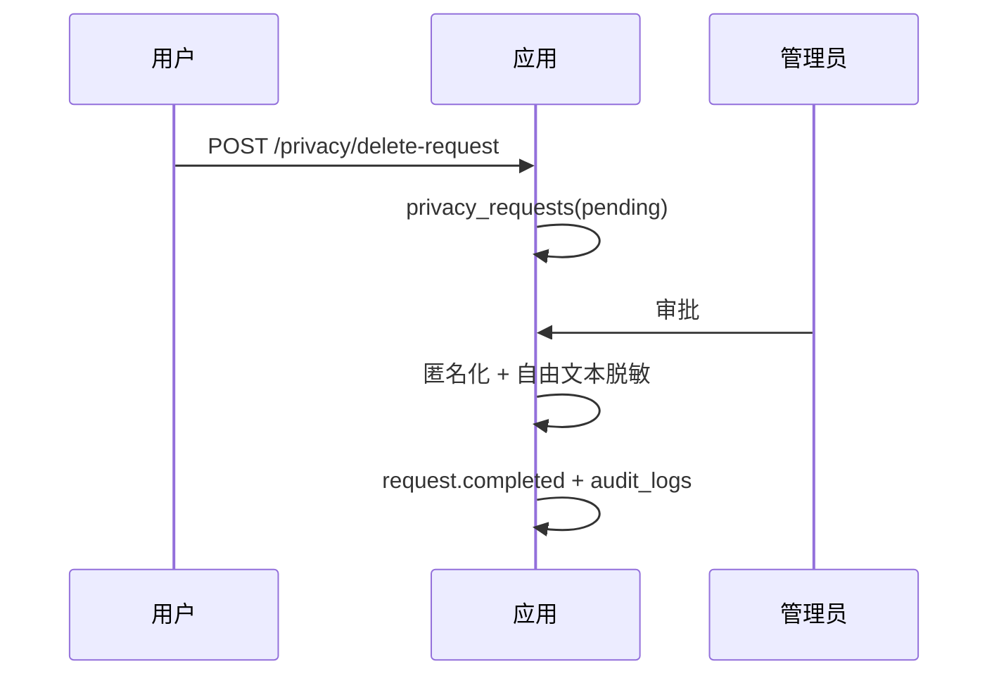

> **Note:** This technical guide is currently maintained in Chinese. The interactive map and product pages are fully bilingual; the detailed engineering reference below remains in Chinese until an English edition is published.


> 学习目标：分清“应用层已闭环”“数据平台待窗口”“正式测评外部”三件事，能独立跑一次合规自检和证据核验。
> 规范文档：`doc/thirdpart/11`、`doc/thirdpart/compliance/dengbao-level3-selfcheck.md`、`doc/thirdpart/compliance/remediation-2026-11-25.md`

---

## 1. 等保三级技术自检：84.8%

| 统计 | 数量 |
|---|---:|
| 符合 | 16 |
| 部分符合 | 7 |
| 外部依赖 | 5 |
| 不符合 | 0 |
| 技术自检得分 | **84.8%** |

> 这是**技术自检**，不是测评报告。正式测评必须由具备资质的测评机构出具。

### 1.1 已闭环的控制项

- 身份鉴别：强密钥、bcrypt、JWT、token_version 撤销、登录限流；
- 访问控制：四级角色 + 自定义角色、15/15 系统管理写接口权限化；
- 安全审计：DB 审计 + 操作 JSONL SHA-256 哈希链 + 敏感字段脱敏；
- 数据完整性：核心表行数/ID/内容哈希 + 对象 SHA-256 基线；
- 数据备份恢复：每日备份 + 每周恢复演练（临时库校验）；
- 个人信息：导出、删除申请、审批、匿名化/脱敏；
- 数据留存/销毁：策略 + CLI/API + 每日 timer，审计 ≥180 天；
- 供应链：SCA/SBOM、镜像安全补丁层；
- 会话安全：访问令牌 120 分钟。

### 1.2 部分符合 / 外部依赖

| 项 | 现状 | 责任方 |
|---|---|---|
| 生产 TLS 证书 | 应用支持 SSL_CERTFILE；Nginx TLS 样例就绪 | 运维/CA |
| SIEM 集中留存 | 支持 HTTP/syslog 转发；未接实际 SIEM | 运维 |
| 依赖漏洞 | CI 最小环境 3 条无上游修复；镜像已加 6 个补丁 | 研发/安全 |
| 渗透/代码审计 | 未做 | 安全/第三方 |
| 三员分立 | 权限可拆分；账号与审批需组织落地 | 组织 |
| 存储加密证明 | S3 SSE 支持；DB 盘/KMS 外部 | 基础设施 |
| 等保正式测评 | 技术自检 84.8% | 测评机构 |

---

## 2. 隐私：导出、删除、留存

### 2.1 导出

```http
GET /api/v1/privacy/export
Authorization: Bearer <token>
```

- 25 个集合，含 `conversation_messages`；
- 账号、会话、练习、掌握度、任务、讨论、课堂回应、审计等；
- 响应 `Cache-Control: no-store`。

### 2.2 删除



- 用户名/邮箱改为 `deleted_<id>_<random>`；
- 密码随机化、`is_active=false`、`token_version+1`；
- 答题文本、讨论正文、任务提交、课堂回答等替换为占位符；
- 保留成绩/完成度/掌握度等统计聚合。

### 2.3 留存

| 数据 | 默认 |
|---|---|
| 对话正文 | 365 天 |
| 学习会话 | 1095 天 |
| 教学事件/xAPI | 365 天（仅已投递/已发送） |
| AI 工具运行 | 180 天 |
| 转码任务 | 90 天 |
| 管理/操作审计 | 365 天，**最低 180** |

执行：`scripts/run_retention.py --dry-run/--apply`、`/api/v1/privacy/retention/run`、每日 03:30 timer。

---

## 3. 审计防篡改

`logs/operation_audit.jsonl`：

```json
{"ts":"...","method":"POST","path":"/api/v1/...","prev_hash":"...","hash":"..."}
```

- `hash = sha256(canonical(entry))`；
- `prev_hash` 指向上一条；
- 写文件 `flock` + `fsync`；
- 校验：`GET /api/v1/system/audit-logs/verify`；
- 导出：`GET /api/v1/system/audit-logs/operations/export`；
- 可选 SIEM/syslog 转发。

> 旧历史行没有哈希链时会显示 `legacy` 计数；新写入从空 `prev_hash` 开始建链。

---

## 4. 供应链与镜像

- `scripts/sca_scan.py`：pip-audit + CycloneDX SBOM；
- CI 最小环境：82 组件、3 条无上游修复（ecdsa/python-jose），补偿控制为 JWT 仅 HS256；
- 运行镜像 `open-llm-vtuber-app:gpu` 叠加：
  - aiohttp 3.13.4
  - cryptography 46.0.7
  - python-multipart 0.0.22
  - urllib3 2.7.0
  - pyjwt 2.12.0
  - pillow 12.3.0
- 镜像层 Trivy 扫描由运维补充。

---

## 5. 备份与恢复

```bash
# 备份
bash scripts/backup_postgres.sh

# 恢复演练（临时库，不覆盖生产）
bash scripts/restore_drill.sh

# 完整性基线
.venv/bin/python scripts/integrity_check.py
```

- 每日 02:30 备份；
- 每周日 04:30 恢复演练；
- 证据：`doc/thirdpart/compliance/evidence/restore-drill-*.json`。

---

## 6. 动手练习

1. 运行 `.venv/bin/python scripts/dengbao_selfcheck.py`，看分数与统计。
2. 用管理员令牌调用 `/api/v1/privacy/export`，检查集合数量。
3. 调用 `/api/v1/system/audit-logs/verify`，看 `hashed`/`legacy`。
4. 运行 `.venv/bin/python scripts/sca_scan.py --out-dir /tmp/sca`，看漏洞数。
5. 运行 `bash scripts/restore_drill.sh`，看临时库表数/用户数/耗时。

---

## 7. 自测题

1. 为什么 84.8% 不能写成“已通过等保三级”？
2. 删除申请为什么保留统计聚合？会不会违反“删除权”？
3. 审计哈希链能发现哪些篡改？不能发现什么？
4. 应用层多租户和数据平台多租户的边界是什么？
5. 依赖漏洞为什么是“报告制”？补偿控制是什么？
