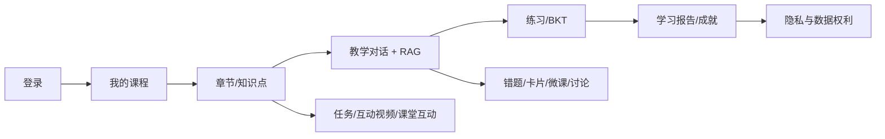
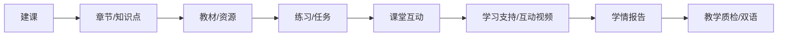
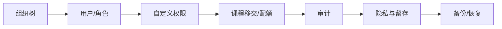

> **Note:** This technical guide is currently maintained in Chinese. The interactive map and product pages are fully bilingual; the detailed engineering reference below remains in Chinese until an English edition is published.

> 学习目标：走通三条角色路径，理解每个动作产生什么数据、落到哪张表。
> 规范文档：`doc/solution/02-zhixi-user-manual.md`、`doc/function/59`、`doc/function/47`

---

## 1. 学生路径

### 1.1 登录与身份

- JWT 120 分钟；
- 改密/停用递增 `token_version`；
- 未登录 302 到 `/login.html`；
- 多校由平台管理员在系统管理切换，业务页不出现租户概念。

### 1.2 教学对话

- 教材 RAG，回答带引用；
- 支持多轮、打断、降级；
- 语音输入 faster-whisper，TTS edge-tts；
- 对话正文写 `conversation_messages`，新写入绑定 `user_id`。

### 1.3 练习与 BKT

- 题目持久化到 `practice_questions`；
- 答案写 `practice_answers`；
- BKT 更新掌握度/薄弱点；
- 练习提交可触发任务点自动完成。

### 1.4 学习支持

- 错题集从练习错题聚合；
- 知识卡片、微课、讨论区；
- 讨论帖子/回复/点赞落 `discussion_*` / `engagement` 表。

### 1.5 任务与互动视频

- 任务：作业/问卷/审批/直播/共建/报名/提交/批阅/克隆；
- 互动视频：时间点测验/批注/知识点/投票；作答绑定互动点，替换视频不丢成绩；
- 弹幕、虚拟剪辑、视频版本。

### 1.6 报告与数据权利

- 学习报告五页签；
- 成就/积分；
- 设置 → 关于 → 隐私与数据：导出、删除申请。

---

## 2. 教师/教研路径

关键能力：

| 能力 | 入口 | 证据 |
|---|---|---|
| 课程/门户/团队/映射 | 课程中心 | `/api/v1/courses`、`course_portal.py` |
| 富文本/导入导出/SCORM | 课程内容 | `rich_text_service.py`、`chapter_import_service.py` |
| 任务引擎 | 任务引擎 | `smart_course/tasks.py`、`task_ext.py` |
| 课堂互动 | 课堂互动 | `teaching/api/classroom.py` |
| 学习支持 | 学习支持 | `teaching/api/engagement.py` |
| 互动视频 | 互动视频 | `teaching/api/video.py` |
| AI 工具台 | AI 工具台 | `toolbox.py`、`text_tools.py` |
| 双语译制 | 双语译制 | `bilingual.py` |

---

## 3. 管理员路径

### 3.1 组织与用户

- 校区/年级/班级树，支持 CSV 批量导入；
- 用户新增/编辑/停用、CSV 导入、密码重置；
- 角色：平台管理员、学校管理员、教师、学生；
- 租户自定义角色：权限 JSON 叠加内建角色。

### 3.2 审计

- 管理动作写 `audit_logs`，详情自动脱敏；
- 所有写请求写 `logs/operation_audit.jsonl`，含 `prev_hash`/`hash`；
- `/api/v1/system/audit-logs/verify` 校验；
- `/operations/export` 导出 JSONL。

### 3.3 隐私与留存

- 导出本人数据；
- 删除申请 → 管理员审批 → 匿名化 + 自由文本脱敏；
- 保留成绩/完成度/掌握度等统计聚合；
- 每日 03:30 留存，审计留存 ≥180 天。

---

## 4. 每个动作落到哪

| 动作 | 主要表 |
|---|---|
| 登录 | `users`、`audit_logs` |
| 选课/学习 | `learning_sessions`、`learning_records` |
| 对话 | `conversation_messages`（`user_id`） |
| 练习 | `practice_questions`、`practice_answers`、`bkt_states` |
| 任务 | `tasks`、`task_groups`、`task_points`、`task_progress` |
| 任务扩展 | `task_cobuilders`、`task_enrollments`、`task_submissions`、`task_live_sessions` |
| 课堂互动 | `classroom_activities`、`classroom_responses` |
| 学习支持 | `discussion_threads`、`discussion_posts`、`discussion_replies` |
| 互动视频 | `video_interactions`、`video_interaction_attempts`、`danmaku`、`video_clips`、`video_versions` |
| 隐私 | `privacy_requests` |
| 审计 | `audit_logs`、`logs/operation_audit.jsonl` |

---

## 5. 动手练习

1. 以学生身份完成一次“选课 → 对话 → 练习 → 报告”。
2. 以教师身份新建一个任务，添加作业/问卷任务点，发布到班级。
3. 以管理员身份创建一个自定义角色，只给 `course.view` + `analytics.view`，分配给测试用户。
4. 在设置 → 隐私与数据导出一次数据，检查 JSON 里是否有 `conversation_messages`。
5. 提交一次删除申请，管理员审批前先看审计记录。

---

## 6. 自测题

1. 为什么删除采用匿名化而不是物理删除？
2. 对话正文的 `user_id` 是什么时候加的？历史数据怎么办？
3. 课堂互动和互动视频分别解决什么教学问题？
4. 自定义角色与内建角色是什么关系？
5. 任务点自动完成的触发条件是什么？
